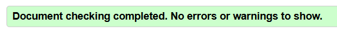

# Валютник — конвертер валют

[](https://github.com/nxkttg/currency-converter/actions/workflows/deploy.yml)

Адаптивний і доступний вебзастосунок для конвертації валют, перегляду курсів та їхньої динаміки. Підтримує понад 160 валют світу, включно з українською гривнею.

**🌐 Демо:** https://nxkttg.github.io/currency-converter/


Індивідуальне завдання з дисципліни «Сучасна веброзробка: HTML, CSS, JS/TS», НУ «Острозька академія».

---

## Зміст

- [Призначення](#призначення)
- [Функціональність](#функціональність)
- [Технології](#технології)
- [REST API](#rest-api)
- [Запуск проєкту](#запуск-проєкту)
- [Структура проєкту](#структура-проєкту)
- [Технічний звіт](#технічний-звіт)
- [Скриншоти](#скриншоти)
- [Можливі покращення](#можливі-покращення)
- [Автор](#автор)

---

## Призначення

«Валютник» допомагає швидко перерахувати суму з однієї валюти в іншу, порівняти курси та оцінити, як змінювався курс за тиждень, місяць, квартал або рік.

Застосунок орієнтований на українського користувача: інтерфейс українською, назви валют українською, курси за замовчуванням показуються відносно гривні.

---

## Функціональність

Застосунок складається з трьох сторінок (MPA).

### 1. Конвертер — `index.html`

- конвертація будь-якої суми між 160+ валютами;
- миттєвий перерахунок під час введення з затримкою (debounce);
- кнопка ⇄ — поміняти валюти місцями;
- валідація суми з зрозумілими повідомленнями (порожнє поле, від'ємне число, нуль, не число);
- підтримка коми як десяткового роздільника та пробілів між розрядами (`1 000,50`);
- популярні курси USD, EUR, PLN, GBP до гривні зі зміною за тиждень;
- історія останніх 10 конвертацій зі збереженням у браузері;
- стан конвертера зберігається в адресі (`?from=EUR&to=UAH&amount=50`) — посиланням можна поділитися.

### 2. Курси валют — `rates.html`

- таблиця курсів усіх валют відносно обраної базової валюти;
- пошук за кодом, українською та англійською назвою (`USD`, «долар», «dollar»);
- фільтри: усі / обрані / дорогоцінні метали;
- сортування за кодом, назвою та курсом кліком на заголовок колонки;
- додавання валют в обране (зберігається між візитами).

### 3. Деталі валюти — `currency.html?code=USD`

- інформація про валюту: назва, символ, коди ISO 4217, дата початку даних;
- інтерактивний SVG-графік курсу за 7 / 30 / 90 / 365 днів;
- підказка при наведенні мишею, керування графіком з клавіатури;
- статистика за період: мінімум, максимум, середнє значення, зміна у %;
- перехід до конвертера з обраною валютою.

### На всіх сторінках

- світла та темна теми (автоматично за системою або вручну, вибір зберігається);
- адаптивний інтерфейс від 320 px до великих екранів;
- стани завантаження (скелетони, спінер) та помилки з кнопкою «Спробувати знову»;
- повна доступність з клавіатури та для програм екранного читання.

### Інтерактивні сценарії

| №   | Сценарій                                       | Сторінка      |
| --- | ---------------------------------------------- | ------------- |
| 1   | Конвертація з миттєвим перерахунком            | Конвертер     |
| 2   | Обмін валют місцями                            | Конвертер     |
| 3   | Валідація введеної суми                        | Конвертер     |
| 4   | Історія конвертацій та її очищення             | Конвертер     |
| 5   | Зміна базової валюти таблиці                   | Курси         |
| 6   | Пошук валюти                                   | Курси         |
| 7   | Фільтрація (усі / обрані / метали)             | Курси         |
| 8   | Сортування таблиці                             | Курси         |
| 9   | Додавання валют в обране                       | Курси, Деталі |
| 10  | Перемикання періоду графіка                    | Деталі        |
| 11  | Перегляд значень на графіку (миша, клавіатура) | Деталі        |
| 12  | Перемикання теми                               | Усі           |

---

## Технології

| Категорія     | Технології                                                                           |
| ------------- | ------------------------------------------------------------------------------------ |
| Розмітка      | HTML5 (семантичні теги, ARIA)                                                        |
| Стилі         | CSS: каскадні шари `@layer`, CSS Variables, `light-dark()`, Grid, Flexbox, `clamp()` |
| Мова          | TypeScript (строгий режим, `noUncheckedIndexedAccess`)                               |
| Збірка        | Vite 8 (multi-page app)                                                              |
| Тестування    | Vitest, jsdom, @vitest/coverage-v8                                                   |
| Якість коду   | ESLint (typescript-eslint), Prettier                                                 |
| Браузерні API | Fetch, AbortController, Intl, localStorage, ResizeObserver, History API              |
| CI/CD         | GitHub Actions, GitHub Pages                                                         |

Сторонні бібліотеки в коді застосунку **не використовуються**: усі компоненти, включно з графіком, написані власноруч.

---

## REST API

Дані надає **[Frankfurter API v2](https://frankfurter.dev/)** — безкоштовний відкритий API курсів валют від центральних банків. Ключ API не потрібен.

Базова адреса: `https://api.frankfurter.dev/v2`

| Ендпоінт                                         | Призначення                             | Де використовується                       |
| ------------------------------------------------ | --------------------------------------- | ----------------------------------------- |
| `GET /currencies`                                | Список валют                            | Випадаючі списки, назви, сторінка деталей |
| `GET /rates?base=UAH`                            | Актуальні курси відносно базової валюти | Таблиця курсів                            |
| `GET /rate/{base}/{quote}`                       | Курс однієї пари                        | Конвертер                                 |
| `GET /rates?base=USD&quotes=UAH&from=YYYY-MM-DD` | Курси за період                         | Графік, популярні курси                   |

Обрано **версію v2**, бо застаріла v1 підтримує лише ~30 валют Європейського центробанку і **не містить гривні**.

### Приклад відповіді

```json
{ "date": "2026-10-18", "base": "USD", "quote": "UAH", "rate": 44.878 }
```

### Обробка помилок

| Ситуація                         | Тип помилки    | Що бачить користувач                                 |
| -------------------------------- | -------------- | ---------------------------------------------------- |
| Немає інтернету                  | `network`      | «Не вдалося з'єднатися з сервером…» + кнопка повтору |
| Сервер не відповідає 10 с        | `timeout`      | «Сервер курсів не відповідає…» + кнопка повтору      |
| HTTP 400 / 404 / 422 / 429 / 5xx | `http`         | Зрозуміле пояснення залежно від коду                 |
| Неочікуваний формат даних        | `invalid-data` | «Сервер повернув дані в неочікуваному форматі»       |
| Запит скасовано (застарів)       | `aborted`      | Нічого — це штатна ситуація                          |

---

## Запуск проєкту

### Вимоги

- [Node.js](https://nodejs.org/) 24 LTS або новіший
- npm 11+
- Git

### Встановлення

```bash
git clone https://github.com/nxkttg/currency-converter.git
cd currency-converter
npm install
```

### Запуск у режимі розробки

```bash
npm run dev
```

Відкрийте http://localhost:5173/

### Команди

| Команда                | Опис                                     |
| ---------------------- | ---------------------------------------- |
| `npm run dev`          | Сервер розробки з миттєвим оновленням    |
| `npm run build`        | Перевірка типів і збірка в папку `dist/` |
| `npm run preview`      | Перегляд зібраної версії                 |
| `npm run typecheck`    | Перевірка типів TypeScript               |
| `npm run lint`         | Перевірка коду ESLint                    |
| `npm run lint:fix`     | Автоматичне виправлення помилок ESLint   |
| `npm run format`       | Форматування коду Prettier               |
| `npm run format:check` | Перевірка форматування                   |
| `npm run test`         | Тести в режимі спостереження             |
| `npm run test:run`     | Одноразовий запуск тестів                |
| `npm run coverage`     | Тести зі звітом про покриття коду        |

---

## Структура проєкту

```
currency-converter/
├── .github/workflows/
│   └── deploy.yml           # CI/CD: перевірки та публікація
├── docs/screenshots/        # Скриншоти для README
├── public/
│   ├── favicon.svg
│   └── robots.txt
├── src/
│   ├── api/                 # Робота з REST API
│   │   ├── frankfurter.ts   #   HTTP-клієнт, обробка помилок
│   │   └── validators.ts    #   Перевірка даних від сервера (type guards)
│   ├── components/          # Робота з DOM
│   │   ├── chart.ts         #   Інтерактивний SVG-графік
│   │   ├── currency-select.ts
│   │   ├── dom.ts           #   Типізовані помічники для DOM
│   │   ├── skeleton.ts
│   │   ├── status.ts        #   Стани завантаження та помилки
│   │   └── theme.ts         #   Перемикач теми
│   ├── pages/               # Точки входу сторінок
│   │   ├── home.ts
│   │   ├── rates.ts
│   │   └── currency.ts
│   ├── services/            # Бізнес-логіка та збереження даних
│   │   ├── currencies.ts    #   Довідник валют з кешуванням
│   │   ├── favorites.ts
│   │   └── history.ts
│   ├── styles/              # CSS, розбитий на каскадні шари
│   ├── types/
│   │   └── api.ts           # Типи даних API
│   └── utils/               # Чисті функції (без DOM і мережі)
│       ├── chart.ts         #   Геометрія графіка
│       ├── convert.ts       #   Валідація суми, обчислення, статистика
│       ├── date.ts
│       ├── debounce.ts
│       ├── format.ts        #   Форматування через Intl
│       ├── rates-table.ts   #   Пошук, фільтрація, сортування таблиці
│       └── storage.ts       #   Безпечна робота з localStorage
├── index.html               # Сторінка «Конвертер»
├── rates.html               # Сторінка «Курси валют»
├── currency.html            # Сторінка «Деталі валюти»
├── eslint.config.js
├── tsconfig.json
└── vite.config.ts
```

Тести розміщено поруч з кодом, який вони перевіряють: `convert.ts` → `convert.test.ts`.

---

## Технічний звіт

### 1. Архітектура

Код розділено на шари за принципом **розділення відповідальності** (Separation of Concerns):

```
pages/        «диригенти» сторінок: зв'язують дані з інтерфейсом
   │
   ├── components/   як показати: робота з DOM
   ├── services/     що робити з даними: кешування, обране, історія
   │
   ├── api/          звідки взяти дані: єдине місце, що знає про сервер
   └── utils/        чисті функції: обчислення та форматування
                     ↑ найлегше тестувати
```

Кожна сторінка працює за схемою **«стан → відображення»**: дії користувача змінюють об'єкт стану, а функція `render()` перетворює стан на DOM.

### 2. HTML і семантика

- семантичні теги: `header`, `nav`, `main`, `section`, `article`, `footer`, `figure`, `figcaption`, `output`, `time`;
- один `<h1>` на сторінку, послідовна ієрархія заголовків;
- форми з `<label>` для кожного поля, `<fieldset>` + `<legend>` для груп радіокнопок;
- таблиця з `<caption>`, `scope="col"` та `scope="row"`;
- `<output>` для результату конвертації — має вбудовану роль `status`;
- `type="text"` + `inputmode="decimal"` замість `type="number"`: немає випадкової зміни значення коліщатком миші, кома працює в усіх браузерах, на телефоні відкривається цифрова клавіатура;
- HTML усіх сторінок пройшов [W3C Validator](https://validator.w3.org/nu/) без помилок.

### 3. CSS

- **Каскадні шари** `@layer tokens, reset, base, layout, components, utilities` — передбачуваний каскад без `!important`;
- **дизайн-токени** в CSS Variables: кольори, відступи, шрифти, радіуси, тіні;
- **світла і темна теми** через `light-dark()` та `color-scheme` — кожен колір задано один раз;
- **mobile-first**: базові стилі для телефона, медіазапити в `rem` додають зміни для ширших екранів;
- **Grid**: `grid-template-areas` для конвертера, `repeat(auto-fill, minmax(min(100%, 13rem), 1fr))` для адаптивних сіток без медіазапитів;
- **Flexbox** для одновимірних розкладок;
- «гумова» типографіка через `clamp()`;
- стилізація станів через ARIA-атрибути (`[aria-current]`, `[aria-pressed]`, `[aria-sort]`) — візуальний стан завжди збігається зі станом для програм читання;
- стилі підключено через `<link>` у `<head>` і тема застосовується інлайн-скриптом до відмальовки — без «спалаху» білого фону (FOUC).

### 4. Доступність (WCAG 2.2)

| Критерій                    | Реалізація                                                               |
| --------------------------- | ------------------------------------------------------------------------ |
| 1.3.1 Інформація та зв'язки | Семантична розмітка, `label`, `fieldset`, `caption`, `scope`             |
| 1.4.3 Контраст              | ≥ 4.5:1 в обох темах                                                     |
| 1.4.4 Зміна розміру тексту  | Розміри в `rem`, працює при масштабі 200%                                |
| 1.4.10 Reflow               | Без горизонтальної прокрутки на ширині 320 px                            |
| 2.1.1 Клавіатура            | Усі функції доступні з клавіатури, включно з графіком (← → Home End)     |
| 2.3.3 Анімації              | `prefers-reduced-motion` вимикає анімації                                |
| 2.4.1 Пропуск блоків        | Посилання «Перейти до основного вмісту»                                  |
| 2.4.3 Порядок фокусу        | Логічний; після видалення елементів фокус переноситься                   |
| 2.4.7 Видимий фокус         | Помітна рамка `:focus-visible`                                           |
| 2.5.8 Розмір цілі           | Інтерактивні елементи ≥ 24×24 px, основні 44×44 px                       |
| 3.1.1 Мова сторінки         | `lang="uk"`                                                              |
| 3.3.1 Ідентифікація помилок | Текст помилки пов'язано з полем через `aria-describedby`, `aria-invalid` |
| 4.1.2 Ім'я, роль, значення  | `aria-label` для кнопок-іконок, `aria-pressed`, `aria-sort`, `aria-busy` |
| 4.1.3 Повідомлення про стан | `role="status"` та `aria-live` для завантаження, помилок, результатів    |

Перевірено: Lighthouse, axe DevTools, проходження лише з клавіатури, програма екранного читання «Екранний диктор» Windows.

### 5. SEO

- унікальні `<title>` і `<meta name="description">` для кожної сторінки;
- на сторінці деталей заголовок і опис змінюються під конкретну валюту;
- Open Graph-теги для поширення в соцмережах і месенджерах;
- `<link rel="canonical">`, `robots.txt`, `theme-color`.

### 6. JavaScript, DOM і події

- **Делегування подій**: один обробник на `<tbody>` замість окремих на кожну зірочку; працює і для нових рядків;
- **debounce**: обчислення та пошук запускаються після паузи у введенні;
- **захист від XSS**: дані з API вставляються лише через `textContent`, а не `innerHTML`;
- **SVG через `createElementNS`**: графік, сітка, підписи та точки малюються з коду;
- **ResizeObserver** перемальовує графік при зміні розміру контейнера;
- **History API** (`replaceState`) зберігає стан у адресі без перезавантаження;
- **керування фокусом** після видалення елементів (очищення історії, зняття з обраного).

### 7. REST API та асинхронність

- `fetch` + `async/await` в окремому модулі `api/frankfurter.ts`;
- `fetch` не вважає HTTP 404/500 винятком, тому статус перевіряється вручну через `response.ok`;
- **тайм-аут 10 с** через `AbortSignal.timeout()`;
- **скасування застарілих запитів** через `AbortController` і `AbortSignal.any()` — немає race condition при швидкому перемиканні валют;
- **перевірка даних під час виконання** (type guards) — застосунок не довіряє серверу наосліп;
- **паралельні запити** через `Promise.allSettled()`: одна недоступна валюта не ламає інші картки;
- **кешування**: курси в пам'яті на 10 хв (перерахунок суми без мережі), довідник валют у localStorage на 12 год з використанням застарілого кешу при відсутності мережі;
- **loading-стани**: скелетони, спінер, `aria-busy`;
- **error-стани**: повідомлення українською та кнопка «Спробувати знову».

### 8. TypeScript

Увесь код застосунку написано на TypeScript у строгому режимі.

| Можливість                | Приклад у проєкті                                                             |
| ------------------------- | ----------------------------------------------------------------------------- |
| Інтерфейси                | `Currency`, `Rate`, `HistoryEntry`, `CurrencyInfo`                            |
| Union-типи замість `enum` | `ApiErrorKind = 'network' \| 'timeout' \| …`                                  |
| Розмічене об'єднання      | `AmountValidation = { ok: true; value } \| { ok: false; error }`              |
| Type guards               | `isRate(value: unknown): value is Rate`                                       |
| Generics                  | `request<T>()`, `getElement<T>()`, `createElement<K>()`, `debounce<Args>()`   |
| Утилітні типи             | `Partial<T>`, `Pick<T, K>`, `Record<K, V>`, `ReturnType<T>`, `ReadonlySet<T>` |
| `unknown` замість `any`   | Усі зовнішні дані (JSON, localStorage) спочатку перевіряються                 |
| `satisfies`               | Перевірка формату кешу без зміни типу                                         |
| Перевірка вичерпності     | `switch` за union-типом без `default`                                         |
| Власний клас помилки      | `ApiError extends Error` з полями `kind`, `status`, `details`                 |

Налаштування: `strict`, `noUncheckedIndexedAccess`, `verbatimModuleSyntax`, `erasableSyntaxOnly`, `noUnusedLocals`, `noUnusedParameters`.

### 9. Тестування

**98 тестів** в 11 файлах, фреймворк Vitest.

| Що тестується | Файл                        | Приклади перевірок                                                                                    |
| ------------- | --------------------------- | ----------------------------------------------------------------------------------------------------- |
| API-клієнт    | `api/frankfurter.test.ts`   | Успішні відповіді, HTTP-помилки, мережеві помилки, тайм-аут, неочікуваний формат (з підміною `fetch`) |
| Обчислення    | `utils/convert.test.ts`     | Валідація суми, конвертація, обернений курс, статистика                                               |
| Форматування  | `utils/format.test.ts`      | Числа, відсотки, дати українською, назви валют                                                        |
| Таблиця       | `utils/rates-table.test.ts` | Пошук, фільтри, сортування, незмінність вхідних даних                                                 |
| Графік        | `utils/chart.test.ts`       | Масштабування координат, побудова SVG-шляхів                                                          |
| Debounce      | `utils/debounce.test.ts`    | Віртуальний час (`vi.useFakeTimers`)                                                                  |
| Сховище       | `utils/storage.test.ts`     | Пошкоджений JSON, невідповідність типу                                                                |
| Сервіси       | `services/*.test.ts`        | Історія, обране                                                                                       |
| DOM           | `components/status.test.ts` | Відображення станів, кнопка повтору                                                                   |

Тести, яким потрібні DOM або localStorage, працюють у середовищі jsdom, решта — у Node.js, що прискорює запуск.

**Покриття коду:** ~89% (`npm run coverage`).

### 10. Якість коду та процес розробки

- **ESLint** з правилами для TypeScript;
- **Prettier** для єдиного стилю коду;
- **Conventional Commits** (`feat:`, `fix:`, `refactor:`, `test:`, `docs:`, `ci:`, `chore:`);
- **Pull Request і code review** для аудиту доступності та налаштування CI;
- **`.gitattributes`** — однакові закінчення рядків (LF) на всіх системах.

### 11. Debugging: приклади з розробки

| Проблема                                          | Як знайдено                                                                      | Рішення                                                                                                              |
| ------------------------------------------------- | -------------------------------------------------------------------------------- | -------------------------------------------------------------------------------------------------------------------- |
| Сторінка без стилів і без JavaScript              | Console: `does not provide an export named 'isRecord'`; `tsc` показав 12 помилок | Додано пропущений `export`. 10 з 12 помилок були наслідком першої: без імпорту type guard TypeScript не звужував тип |
| Білий «спалах» при перезавантаженні в темній темі | Візуальна перевірка, Network                                                     | Тема застосовується інлайн-скриптом у `<head>`, CSS підключено через `<link>`, що блокує відмальовку                 |
| Іконка теми не зафарбовувалась                    | DevTools → Elements → Computed                                                   | `fill="none"` перенесено з `<path>` на `<svg>`: власний атрибут елемента важливіший за успадкований стиль            |
| Неіснуючі адреси показували головну               | Ручна перевірка                                                                  | `appType: 'mpa'` у конфігурації Vite                                                                                 |
| Тести тривали 39 с                                | Підказка Vitest                                                                  | jsdom лише для тестів, яким потрібен DOM: 3 с                                                                        |

### 12. Продуктивність

Lighthouse (мобільний режим, production-збірка):

| Сторінка      | Performance | Accessibility | Best Practices | SEO |
| ------------- | ----------- | ------------- | -------------- | --- |
| Конвертер     | 99          | 100           | 100            | 100 |
| Курси валют   | 96          | 100           | 100            | 100 |
| Деталі валюти | 96          | 100           | 100            | 100 |

Чому застосунок швидкий: немає сторонніх бібліотек, Vite стискає код і додає хеші до імен файлів для кешування, паралельні запити, кешування курсів і довідника валют.

### 13. Публікація

**GitHub Actions** при кожному Pull Request запускає перевірки, а при оновленні `main` — ще й публікацію:

```
push → ESLint → Prettier → TypeScript → тести → збірка → GitHub Pages
         будь-яка помилка зупиняє публікацію
```

`base: './'` у конфігурації Vite робить усі шляхи відносними, тому сайт коректно працює в підпапці `/currency-converter/`.

---

## Скриншоти

| Темна тема                                                   | Мобільна версія                                              |
| ------------------------------------------------------------ | ------------------------------------------------------------ |
|  |  |

**Таблиця курсів**


**Деталі валюти з графіком**


**Стани завантаження та помилки**

| Завантаження                                                                 | Помилка                                                                         |
| ---------------------------------------------------------------------------- | ------------------------------------------------------------------------------- |
|  |  |

**Перевірки якості**

| Lighthouse                                                                     | W3C Validator                                                                     |
| ------------------------------------------------------------------------------ | --------------------------------------------------------------------------------- |
|  |  |

---

## Можливі покращення

- офлайн-режим через Service Worker (PWA);
- порівняння кількох валют на одному графіку;
- end-to-end тести (Playwright) для перевірки сценаріїв у справжньому браузері;
- англійська версія інтерфейсу.

---

## Автор

**[Ім'я Прізвище]**, студентка 3 курсу, спеціальність F3 «Комп'ютерні науки»
НУ «Острозька академія», 2026

Дані: [Frankfurter API](https://frankfurter.dev/). Курси мають довідковий характер.
